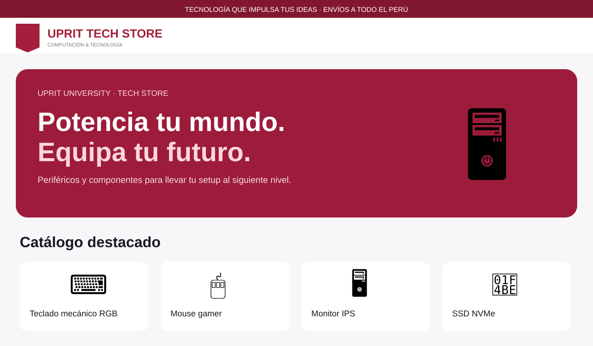
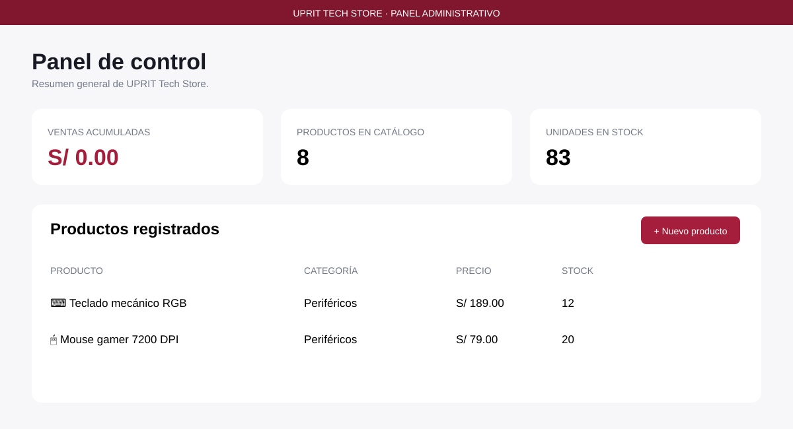
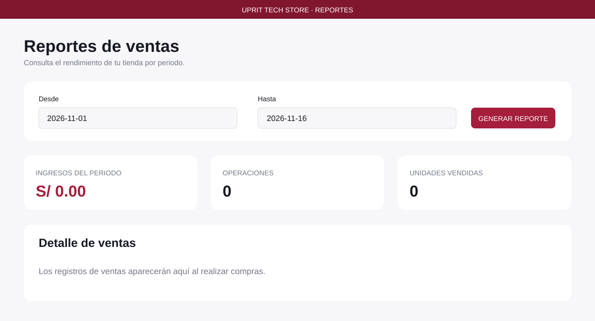

# UPRIT Tech Store

Tienda virtual académica de periféricos y partes de computadora, desarrollada con **Python, Flask y SQLite**. Su identidad visual toma como referencia el logo institucional de la Universidad Privada de Trujillo (UPRIT), con una portada de temática institucional en rojo, blanco y tonos neutros.

## Capturas de la aplicación

### Portada y catálogo de productos


### Panel administrativo


### Reportes de ventas


## Funcionalidades
- Catálogo público de teclados, mouse, monitores, audífonos, memorias RAM, procesadores, tarjetas gráficas, SSD y otros.
- Registro de compras de demostración desde el catálogo.
- Inicio de sesión administrativo.
- Gestión de productos: crear, editar y eliminar.
- Control de inventario y descuento automático del stock al registrar una compra.
- Reportes por rango de fechas: ingresos, operaciones y unidades vendidas.
- Imprimir reporte o guardarlo como PDF desde el navegador.
- Base de datos SQLite creada automáticamente y productos de muestra.

## Tecnologías
Python 3.10+, Flask, SQLite, HTML y CSS.

## Instalación y ejecución local
```bash
git clone https://github.com/ycuri777/PROGRAMACION_Y_DESARROLLO_WEB.git
cd PROGRAMACION_Y_DESARROLLO_WEB
python -m venv .venv
# Windows: .venv\Scripts\activate
# macOS/Linux: source .venv/bin/activate
pip install -r requirements.txt
python app.py
```
Abre http://127.0.0.1:5000 en tu navegador.

## Credenciales de demostración
- **Usuario:** `admin`
- **Contraseña:** `123`

## Funcionamiento
1. El visitante ingresa a la portada y explora el catálogo, las categorías, los precios y el stock.
2. Al registrar una compra de demostración, el sistema guarda la venta en SQLite y descuenta las unidades del inventario.
3. El administrador selecciona **Acceso admin** e inicia sesión con las credenciales indicadas.
4. En **Resumen** consulta las ventas acumuladas, productos registrados y unidades disponibles.
5. En **Nuevo producto** registra nombre, categoría, descripción, precio, stock e ícono. También puede editar o eliminar productos desde el resumen.
6. En **Reportes** selecciona un rango de fechas para consultar ingresos, operaciones, unidades vendidas y el detalle de las ventas. Puede imprimir o guardar el reporte en PDF.

## Configuración antes de publicar en producción
Configura variables de entorno seguras: `SECRET_KEY`, `ADMIN_USER`, `ADMIN_PASSWORD` y `DATABASE_PATH`. Las credenciales `admin / 123` son solo para demostración académica: cámbialas antes de exponer el panel a internet. Para producción se recomienda HTTPS, contraseñas robustas, protección CSRF, limitación de intentos y almacenamiento persistente para la base de datos.

---
Proyecto académico · UPRIT Tech Store · 2026
